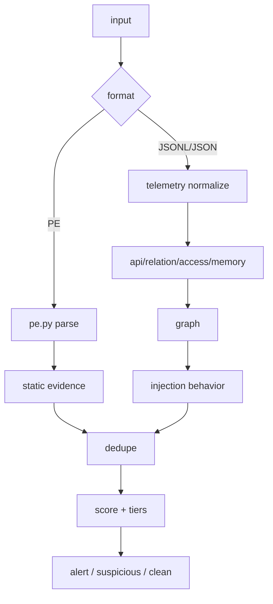

# Footless-detector — multilayered loader detector

Independent detector for the D08/D09 lab. It reads **only** files and
telemetry: PE binaries, JSON/JSONL event records, Sysmon-shaped events, or
pre-shaped evidence. It never imports loader code and never reads
`marker.jsonl` or a run's success messages.

The PoC it is measured against lives in
[`../Footless-loader`](../Footless-loader/README.md).

## 1. What it detects

| Layer | Detector | Signal |
|---|---|---|
| Static PE | `hash_loop` | tight loop with byte load + rotate/imul + compare; FNV/golden-ratio/CRC constants |
| Static PE | `dynamic_resolve` | x64 PEB read (`gs:[0x60]`, MSVC and GCC forms) + hash loop/constants + missing sensitive imports |
| Static PE | `import_anomaly` | no `Nt*/injection` API in the IAT while dynamic resolution indicators exist |
| Static PE | `sensitive_import_cluster` | classic injection IAT cluster (supporting only) |
| Static PE | `rwx_section`, `packed` | RWX section flags; high entropy + tiny IAT |
| Static code | `hash_loop`, `dynamic_resolve`, `import_anomaly` | stub/summary fixtures for unit tests |
| Runtime | `api_chain` | normalized API event chain |
| Runtime | `source_target` | cross-process operation relation |
| Runtime | `remote_thread` | cross-process thread creation |
| Memory | `rwx` | read+write+execute region |
| Memory | `rx_anomaly` | executable region linked to a prior foreign write |
| Access | `access` | strong process/memory rights |
| Graph | `process_graph` | source→target edge with open + memory + execution |
| Correlation | `injection_behavior` | ordered open → memory → executable chain on one PID pair |

## 2. Layout

```text
Footless-detector/
├── main.py                    CLI (routing, JSON envelope, exit codes)
├── detection/
│   ├── pe.py                  dependency-free PE parser + static features
│   ├── engine.py              format routing, event pipeline, dedupe
│   ├── evidence.py            evidence-shape contract + weights
│   ├── scoring.py             tiers, weights, injection-behavior correlation
│   └── graph.py               process relation graph features
├── static/                    hash loop, dynamic resolution, import anomaly
├── runtime/                   api behavior, relation, memory, access, telemetry
├── evaluate.py                manifest evaluator (P/R/F1/FPR + latency)
├── tools/ablation.py          layer ablation report
├── datasets/                  manifest, PE samples, telemetry (labelled)
├── reports/                   evaluation.json/md, ablation, stress
├── tests/                     stdlib unittest suite
├── docs/                      detection and evaluation details
└── GUIDE.md                   original assignment spec (kept)
```

## 3. Usage

```sh
# PE file
python main.py ../Footless-loader/dist/footless_loader.exe

# Loader JSONL, Sysmon JSONL, or a JSON evidence/event batch
python main.py datasets/telemetry/P03_stub.jsonl

# Directory: aggregate all files and correlate once
python main.py datasets/telemetry/

# Ablation / options
python main.py target --format auto|json|jsonl|pe|telemetry
python main.py target --allowlist allowlist.txt --threshold 6 --out result.json
```

Exit codes: `0` clean run (any verdict), `2` bad target/usage, `1` internal
failure. Stdout is one JSON document:

```json
{
  "evidence": [...],
  "warnings": [...],
  "alert": {"alert_id":"alert-1","verdict":"alert","score":17,
            "chains":["..."],"layers":["runtime-api","memory","access-rights","process-graph"],
            "detectors":["api_chain","access","remote_thread","process_graph","injection_behavior"],
            "summary":"correlated 11 evidence items across 4 layers"},
  "verdict": "alert|suspicious|clean",
  "stats": {"evidence_count":11,"warning_count":0,"event_count":12,"layers":[...]},
  "features": [...],   // PE only
  "graph": {...}       // telemetry only
}
```

Malformed input becomes a `warnings` entry; the run continues (FR10).

## 4. Pipeline



Text fallback: `PE -> static` and `telemetry -> runtime -> graph -> correlation`,
then one weighted scoring pass.

## 5. Scoring

Current weights (all 1..3, so one evidence item alone cannot alert):

| Detector | Weight |
|---|---:|
| `hash_loop` | 2 |
| `dynamic_resolve` | 3 |
| `import_anomaly` | 2 |
| `packed` | 2 |
| `sensitive_import_cluster` | 2 |
| `rwx_section` | 3 |
| `api_chain` | 1 |
| `source_target` | 1 |
| `remote_thread` | 3 |
| `rwx` | 3 |
| `rx_anomaly` | 2 |
| `access` | 2 |
| `process_graph` | 2 |
| `injection_behavior` | 2 |
| `process_tampering` | 3 |

Tiers:

- `alert`: weighted score ≥ 6 **and** evidence spans ≥ 2 distinct areas.
- `suspicious`: 3..5, or a single indicator (even weight 3).
- `clean`: below 3.

This is why a bare RWX region (weight 3, one area) is never an alert, while
the loader's `hash_loop + dynamic_resolve + import_anomaly` spans `static`
and `static_pe` and does alert.

## 6. False-positive handling

Structural controls:

- single-indicator guard;
- require ≥ 2 layers;
- same-process operations are not source→target relations;
- bare RX (image-backed code) is normal; only RX + prior **foreign** write
  becomes `rx_anomaly`;
- weak access rights (`PROCESS_QUERY_INFORMATION`) do not emit `access`;
- image load alone is never an alert;
- graph needs open + memory + execution on one edge.

Operational controls:

- `--allowlist FILE` (basename per line, `#` comments) removes runtime
  evidence from trusted sources and static evidence for allowlisted files;
- `--threshold N` raises/lowers the alert bar;
- stress set `datasets/stress_manifest.csv` documents the residual risk
  (authorized debuggers look like injectors).

## 7. Dataset

`datasets/manifest.csv` is the **core benchmark** (22 rows):

- 6 benign telemetry scenarios (target-only, self-load, normal app, resolver
  noise, JIT RWX, weak query);
- 8 malicious telemetry scenarios (CRT, NtCreateThreadEx, stub, APC,
  section, quiet, image-start, Sysmon correlation);
- 5 malicious PE variants (baseline, seeded, module-api, quiet, seed-alt);
- 3 benign PE controls (ordinary app, target, marker DLL).

`datasets/stress_manifest.csv` is a separate 4-row stress set for limits
(debugger FP, installer TN, classic Win32 injector static FN, same injector
runtime TP).

> The telemetry JSONL in `datasets/telemetry/` is a **synthetic replay** of
> the loader event contract, generated by `datasets/generate_telemetry.py`.
> It is labelled as such. Replace it with real `loader.jsonl`/Sysmon captures
> from the VM runbook; the evaluator is unchanged.

## 8. Results

Core benchmark (22 rows):

| TP | FP | TN | FN | Precision | Recall | F1 | FPR |
|---:|---:|---:|---:|---:|---:|---:|---:|
| 13 | 0 | 9 | 0 | 1.000 | 1.000 | 1.000 | 0.000 |

Latency: p50 ≈ 0.19 ms, p95 ≈ 18 ms (PE parsing dominates; JSONL < 1 ms).

Layer ablation:

| Configuration | Recall | F1 |
|---|---:|---:|
| full | 1.000 | 1.000 |
| static-only | 0.385 | 0.556 |
| runtime-only | 0.615 | 0.762 |
| no-graph | 1.000 | 1.000 |
| no-static-pe | 0.615 | 0.762 |

Stress set: P=0.50, R=0.50, F1=0.50, FPR=0.50 — intentional limits.

Full details: [`reports/evaluation.md`](reports/evaluation.md),
[`reports/ablation.md`](reports/ablation.md),
[`reports/stress_evaluation.md`](reports/stress_evaluation.md),
[`docs/EVALUATION.md`](docs/EVALUATION.md).

## 9. Tests

```sh
# Populate local PE samples from the loader build first:
python tools/sync_samples.py
python -m unittest discover -v
```

69 tests cover static/runtime detectors, PE parsing, telemetry adapters,
graph features, engine routing/alerting/warnings, and metric math.

## 10. Reproduce

```sh
python datasets/generate_telemetry.py
python evaluate.py
python tools/ablation.py
python evaluate.py --manifest datasets/stress_manifest.csv \
  --out reports/stress_evaluation.json --markdown reports/stress_evaluation.md
python -m unittest discover
```

## 11. Limits and threat model

- Static heuristics are indicators. Obfuscation, different hash algorithms,
  or a non-PEB resolver can evade them; runtime layers are required.
- Behavioural detection cannot distinguish an authorized debugger from an
  injector without signature/allowlist context (see X01).
- A classic injector with a visible IAT intentionally has no static alert
  (X03); its runtime chain does alert (X04).
- Sysmon does not record every `VirtualAllocEx`/`WriteProcessMemory`; missing
  event classes must be reported as coverage gaps, not `no_alert`.
- PID reuse and clock skew mean real deployments need process GUIDs and
  correlation windows; the dataset uses explicit IDs for reproducibility.
- The detector is offline, stdlib-only, no network, no model download.

## 12. Rubric map

| Rubric | Where |
|---|---|
| C. Detector + features | `detection/`, `static/`, `runtime/`, this README, `docs/DETECTION.md` |
| C. Multi-layer + FP | `detection/scoring.py`, `detection/graph.py`, `--allowlist`, stress set |
| D. Metrics + reproduction | `evaluate.py`, `reports/`, `docs/EVALUATION.md` |
| D. Safety/lab | `../SAFETY.md`, `../Footless-loader/docs/RUNBOOK.md` |
